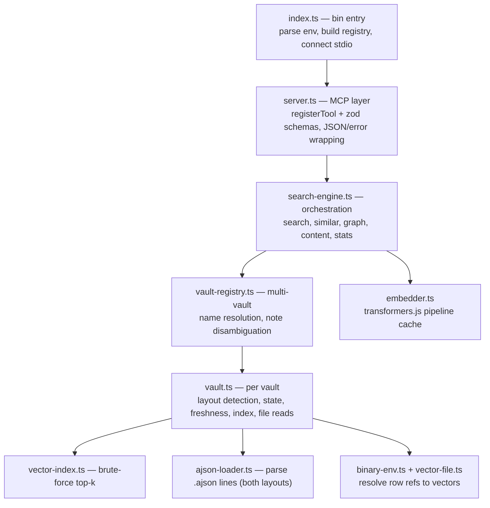

# CODEBUDDY.md This file provides guidance to CodeBuddy when working with code in this repository.

## Commands

- `npm install` — install deps. `@huggingface/transformers` pulls onnxruntime (~50–75MB, cached after first install).
- `npm run build` — `tsc` → `dist/`. Required before anything that reads `dist/` (the E2E test spawns `dist/index.js`, and `smoke`/`start` import from `dist/`).
- `npm run watch` — incremental `tsc --watch`.
- `npm test` — `npm run build && vitest run`. The default CI tier: no network, uses fixture vaults with fake 8-dim vectors.
- `npm run test:live` — `LIVE_TESTS=1 vitest run`. Opt-in tier that downloads the real `TaylorAI/bge-micro-v2` model (~25MB once) and asserts real semantics. Excluded from the default run via `vitest.config.ts`.
- Single test file — `npx vitest run test/vector-index.test.ts` (config only picks up `test/**/*.test.ts`).
- Single test by name — `npx vitest run -t "topK"`.
- Smoke against a real vault (build first) — `npm run smoke -- "/path/to/vault" "your query"`.
- Run the server locally — `SMART_VAULT_PATH="/path/to/vault" npm start`.

No linter or formatter is configured; `tsc` under `strict` is the only static check.

## Architecture

An MCP **stdio** server that gives an LLM semantic search over one or more Obsidian
vaults by *reading* the embeddings the Smart Connections plugin already wrote to
`.smart-env/`, and *embedding the query* locally with the same model. No cloud calls.

Module layering (data flows bottom→top; each layer only knows the one below):

**Data source — two layouts, auto-detected.** `Vault.load` needs
`<vault>/.smart-env/smart_env.json` plus at least one of:

- **`binary`** (current plugin): `smart_sources/smart_sources.ajson` holds
  `"smart_sources:<path>": {…}` entries with **no inline vectors**. Note metadata and
  *all* block metadata (line ranges, `should_embed`) live in the source's `blocks_data`
  (keyed by heading); a block is indexed iff its entry has a resolvable embedding ref.
  `embedding.default.<file>: {file, file_i}` points at row `file_i` of the binary
  float32 file `smart_sources/<file>` (notes) or `smart_blocks/<file>` (blocks), which
  has no header — row `i` starts at byte `i * dims * 4`. `dims` and the real
  `model_key` come from `embedding_models/embedding_models.ajson`, selected via
  `smart_env.json` → `embedding_models.default_model_key`. `binary-env.ts` resolves all
  this into the same normalized `VaultData` (inline `vec`, keyed by model key) that the
  older layout produces, so nothing above `vault.ts` knows which layout is in play.
- **`legacy`**: `multi/*.ajson`, vectors inlined at `embeddings.<modelKey>.vec`, one
  `smart_blocks:` entry per block.

Both use the same line-oriented AJSON format — `"<collection>:<key>": {json},`, append
semantics (later lines win, `null` deletes the key) — parsed by `readAjsonEntries`.
The library prefers `binary` when present, since an upgraded vault can leave a stale
`multi/` behind. Frontmatter blocks are skipped at index time.

**Block heading keys changed with the layout.** Legacy keys are `Note.md##Intro`
(path + heading, heading carrying its own `#`) and new ones are `Note.md#Intro`.
Either way the note path is everything before the first `#` (`blockNotePath`), the
heading is the remainder, and that remainder is what `include_blocks` expects and what
search results return as `block`.

**Vectors.** `VectorIndex` stores L2-**normalized** `Float32Array`s keyed by id, so
similarity is a plain dot product over a brute-force scan + partial sort. This is a
deliberate non-goal: no SQLite/external vector store — brute force handles 10k+ notes
in milliseconds, and a native dep would complicate `npx` installs. Do not "optimize"
this into an ANN index without cause. Entries carry `kind: 'note' | 'block'` and
`notePath`.

**Query embedding.** `Embedder` lazily loads and caches one transformers.js
feature-extraction pipeline per model key, trying variants in order: `{modelKey,
Xenova/<basename>}` × `{fp32, q8}`. First load runs a **parity check** — it embeds a
stored note's text and requires cosine > 0.99 against that note's stored vector
(via `Vault.paritySample`); a mismatch warns that rankings may drift from Smart
Connections. `clampTokenizerToModel` overrides a placeholder `model_max_length`
(some models ship `1e30`) with the model's real `max_position_embeddings`, so
truncation happens at the token level — this is what keeps non-English/CJK/code
inputs from crashing onnxruntime (CHANGELOG #10). Any failure to load a model raises
`EmbedUnavailableError`, which callers treat as a signal to fall back.

**Two model keys per vault.** `smart_env.json`'s declared `model_key` can lag behind
the data (changing models re-embeds every `.ajson` under a new key but may leave the
old one in config, silently emptying the index). `Vault.reconcileModelKey` trusts the
data: it keeps the declared key only while it still has vectors, otherwise adopts the
key that actually carries embeddings, logs the override to stderr, and surfaces the
config value as `declaredModelKey` in `get_stats`/`list_vaults`. Always index/lookup
via `vault.modelKey`, never the declared key.

**Freshness.** There are no watchers or timers. `Vault.maybeReload()` is called at the
start of every tool that touches a vault; it throttles to one check per 2s, compares an
`mtime:size` snapshot of the layout's files (`multi/*.ajson`, or
`smart_sources|smart_blocks|embedding_models/*`), and only re-reads the data when that
snapshot changed. Reloads are whole-vault, not incremental. A read failure clears the
snapshot so the next check retries rather than assuming the vault is up to date. (The
design doc in `docs/superpowers/specs/` mentions a `freshness.ts` module that was
folded into `vault.ts` — the code is authoritative.)

**Vault & note addressing.** Vault names are directory basenames, disambiguated with a
numeric suffix on collision. A load failure is captured per-vault (reported by
`list_vaults`/`get_stats` and stderr), not thrown; the server only exits if *zero*
vaults load. Tools take an optional `vault`; omit it to search across all and
re-rank, or for note-addressed tools to auto-resolve — which throws
`AmbiguousNoteError` if the same path exists in multiple vaults.

**Search & graceful degradation.** `SearchEngine.search` embeds the query per vault and
merges results. Degradation is explicit and never silent:
`mode: "keyword-fallback"` (with a `warning`) only when *every* vault fell back;
otherwise `mode: "semantic"`, fallback rows carry `match: "keyword"` and always sort
after true semantic rows. Fallback is triggered by `EmbedUnavailableError` **or** an
empty index (`size === 0`, e.g. embeddings not generated yet). Keyword scoring is
literal substring counting — query text is never interpolated into a `RegExp`.
`similar`/`graph` use only stored note vectors (no model needed) and throw
`EmbedUnavailableError` when a note has no stored embedding; the graph walk tolerates
that for non-root nodes and skips expanding them.

**Safety.** All note reads go through `resolveInsideVault`, which resolves against the
vault root and rejects paths that escape it (`PathEscapeError`). Errors thrown in tools
are converted to `{ error }` MCP results with `isError: true` by the `guard` helper in
`server.ts`; the server stays up.

## Conventions & gotchas

- ESM + `moduleResolution: NodeNext`: **relative imports must end in `.js`** even
  though the source is `.ts` (`import { Vault } from './vault.js'`).
- `SearchEngine` depends on the `QueryEmbedder` interface, not the concrete `Embedder`
  — this is the injection seam tests use to avoid downloading models. Keep it.
- The six tools live in `server.ts` as the MCP surface; adding a tool means adding
  both the zod `inputSchema` and the `engine` method, and usually a test in
  `server.test.ts` (`InMemoryTransport`) plus `test/e2e-stdio.test.ts`.
- CI tests must not hit the network. New fixture vaults use synthetic tiny vectors and
  a fake model key (`test-model-8d`); anything needing the real model goes under
  `test/live/` and is gated by `LIVE_TESTS`. `test/fixtures/vault-a` covers the legacy
  layout, `test/fixtures/vault-binary` the binary one (8-dim vectors written with
  `Buffer.writeFloatLE`, plus deliberate edge cases: a deleted source, a source with no
  vector, and a row reference past EOF). **A layout change must keep both green.**
- `Vault.maybeReload` tests pass explicit timestamps; `lastCheck` starts at `0`, so any
  `now` below the 2s throttle is silently ignored.
- `test/e2e-stdio.test.ts` spawns the built `dist/index.js` with `HF_HUB_OFFLINE=1`, so
  run `npm run build` (what `npm test` already does) before expecting it to pass.
- The server is a reader + query-embedder only: it never generates embeddings for notes
  Smart Connections hasn't embedded.